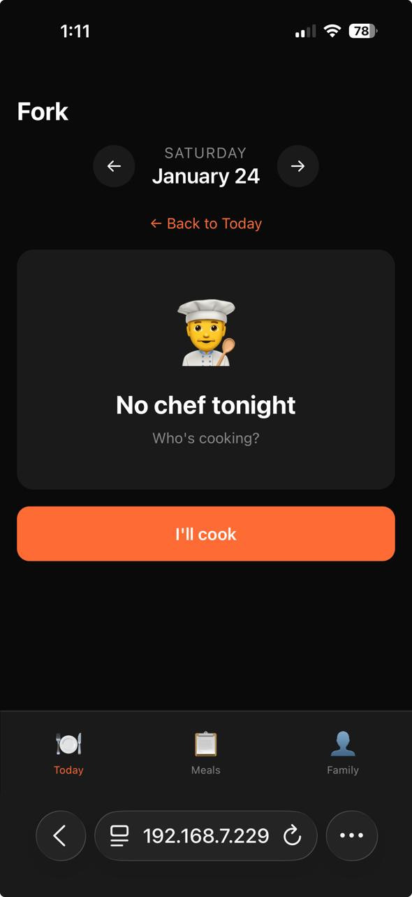
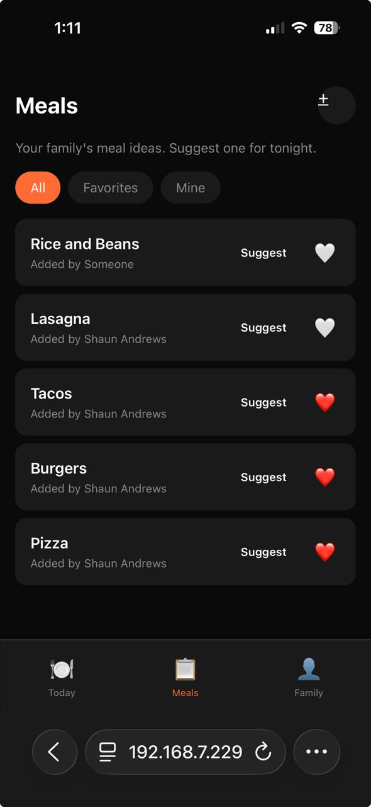
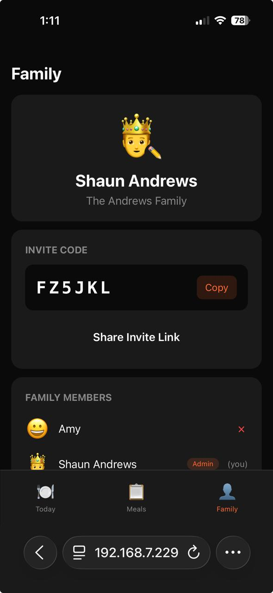

# 🍴 Fork

**What's for dinner?** Fork helps families decide without the nightly negotiation.

Family members suggest meals, vote on what sounds good, and whoever's cooking picks the winner. Everyone gets notified. Dinner: decided.

## Screenshots

<p align="center">
  
  
  
</p>

## How It Works

1. **Create a family** — invite your household via link or code
2. **Suggest meals** — anyone can add ideas anytime
3. **Vote** — heart meals that sound good
4. **Volunteer to cook** — claim a day you want to be chef
5. **Chef picks** — choose from suggestions, informed by votes
6. **Everyone knows** — push notification when dinner is decided

## Core Principles

- **Simple over feature-rich** — this is a decision tool, not a recipe manager
- **Low friction** — suggesting a meal takes 5 seconds
- **The cook decides** — votes are influence, not binding
- **Everyone participates** — even the kids

## Tech Stack

- React 19 + Vite
- Firebase (Auth, Firestore)
- PWA-ready (mobile-first, push notifications)

## Development

```bash
cd app
npm install
npm run dev
```

Open [http://localhost:5173](http://localhost:5173) to view it in your browser.

## Status

🚧 MVP in progress

---

*Built with love (and hunger) by the Andrews family.*
